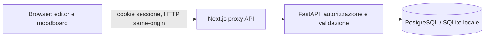

# Architettura — Fasi 0 e 1

Interfaccia italiana desktop-first. Next.js/React e Konva gestiscono la pianta;
FastAPI valida e autorizza tutte le operazioni; SQLAlchemy persiste su PostgreSQL.
SQLite è un'alternativa locale esplicita per sviluppo e test, senza servizi esterni.
Nessuna integrazione IA esterna: due direzioni DEMO deterministiche.

## Contratti e confini di fiducia
Il browser non è attendibile. Il server verifica proprietario, schema, revisione e
lock prima di scrivere. Nessun dato cliente reale nel demo. Login con due account
DEMO e password configurabili; sessioni opache con scadenza, cookie HttpOnly,
SameSite strict; in produzione HTTPS e COOKIE_SECURE=1 sono obbligatori.
Non usare credenziali demo su un deployment pubblico. Nessuna chiave nel frontend.
Esportazioni locali PNG e JSON; nessun caricamento o invio a provider esterni.

Coordinate canoniche: millimetri, X/Y sul piano, Z altezza; canvas Y crescente
verso il basso, conversione visuale esplicita. Coordinate e dimensioni non dipendono
dallo zoom. Muri con UUID stabili; aperture con wallId e offset dall'inizio muro.
Poligoni semplici, almeno tre vertici, muri >=100 mm; aperture contenute e non
sovrapposte. Modifiche che invalidano aperture vengono rifiutate, mai corrette
silenziosamente. Elementi demo senza SKU o marchi reali.

Undo/redo conserva stati locali completi. Salva crea uno snapshot immutabile;
ripristinare una versione crea una nuova revisione. Controllo ottimistico tramite
expectedRevision; un conflitto restituisce 409 senza sovrascrivere dati.
Le finiture si modificano separatamente dalle coordinate, rispettando i lock.

API: POST /api/login, POST /api/logout, GET /api/me; GET/POST /api/projects;
GET/PUT /api/projects/{id}; GET /api/projects/{id}/versions;
POST /api/projects/{id}/restore/{revision}. Tutte salvo login richiedono sessione.
Lo schema OpenAPI completo è disponibile nel backend su /docs.

## Limiti deliberati
Niente 3D, listini, SKU verificati, PDF commerciale, upload o IA generativa.
Collisioni mobili non bloccanti rinviate alla fase 3. Autenticazione demo non
sostituisce identity provider, recovery, rate limiting e audit di produzione.
Schema iniziale SQLAlchemy con versione; migrazioni incrementali successive
richiederanno Alembic prima di cambiare struttura. Non dichiarare produzione pronta.

## Incremento catalogo (22 ottobre 2026)

Modulo `backend/catalog.py`, migrazione additiva idempotente versione 2 e file
campione esterni al DB. Catalogo privato per proprietario con revisioni, approvazione
e archiviazione logica. Snapshot immutabili dentro le scene: nessun aggiornamento
retroattivo dei progetti. Il server verifica nuove referenze e compatibilità.
Il proxy Next ora trasmette corpi binari senza conversione in testo e impone
limiti di dimensione. I campioni vengono decodificati e riscritti in PNG senza
metadati. Il volume Compose `studio-assets` conserva i file tra riavvii.
Contratti, licenze, CSV e limiti in [catalog.md](catalog.md).

## Desktop Windows (0.3.0)

Electron avvia un'API nativa PyInstaller e Next standalone usando il proprio Node.
DB SQLite e asset sono nel profilo utente, separati dalle risorse installate.
Porte loopback dinamiche, due chiavi di processo, login locale solo desktop;
renderer senza Node, sandbox e contextIsolation attivi. L'uscita chiude le pipe
ai servizi: anche un arresto anomalo del supervisore termina i processi figli.
Il backup ferma i servizi e copia insieme DB, chiave e campioni con manifest.
La compilazione dell'installer richiede Windows; il cloud Linux verifica i servizi,
la finestra Electron in modalità headless e la compatibilità del flusso web.
Vedi [windows-desktop.md](windows-desktop.md) per limiti, build e collaudo.

## Biblioteca cucina integrata (0.4.0)

`backend/kitchen.py` aggiunge importazione del pacchetto privato verificato,
indice locale SQLite FTS5, categorie e ricerca, provenienza e pagine della fonte.
Le nuove tabelle versione 3 conservano riferimento al catalogo ed elenchi per
proprietario/progetto, con revisioni e snapshot. L'indice è sotto ASSET_DIR,
coperto dal backup. Nessuna modifica a scene o prodotti precedenti.
`frontend/app/kitchen.tsx` integra consultazione, preferiti e articoli del progetto.
Dettagli, API e limiti in [kitchen-in-app.md](kitchen-in-app.md).
